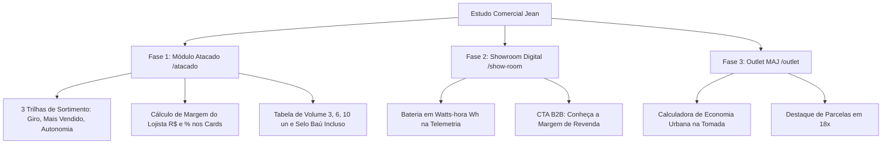

# Estudo Estratégico: Posicionamento Comercial, Canais de Venda e Revendas MAJ Mobilidade

> **Documento Oficial de Engenharia Comercial e Inteligência de Mercado**  
> **Origem:** Análise e estudo conduzido por Jean / MAJ Mobilidade  
> **Data:** Outubro de 2026  
> **Status:** Aprovado para implementação nos canais digitais do M-One (`/show-room`, `/atacado`, `/outlet`)  
> **Referência Externa:** [ChatGPT Study Archive](https://chatgpt.com/s/t_6ae2028c0b448191b53dc62f4912d760)

---

## 1. Contexto Operacional & O Desafio das Vendas

A rede de lojistas e revendedores da **MAJ Mobilidade** reportou desaceleração nas vendas na ponta final e retenção de pedidos de recompra. Ao investigar a dinâmica de compra dos lojistas frente aos concorrentes diretos (Panda, Ebike Atacado, Sudu, Novo 1910 e LAF), constatou-se que o problema central não é a qualidade dos veículos, mas sim **a forma como a oferta e a precificação são comunicadas**.

A MAJ historicamente enviava tabelas extensas em planilhas ou PDFs técnicos, exigindo esforço cognitivo excessivo do comprador B2B para entender viabilidade econômica, margem de revenda e custo pós-venda.

---

## 2. Diagnóstico dos Concorrentes: O que o Mercado Comunica

| Concorrente | Estratégia Visual & Comercial | Impressão Passada ao Lojista |
| :--- | :--- | :--- |
| **Panda** | Foto, especificação e preço no mesmo quadro. Preço âncora grande e imediato. | Vende rápido pelo impacto visual inicial. Ex: Modelo GT20 anunciado a R$ 5.100 (1.000W, 48V 15Ah). |
| **Ebike Atacado** | Compra por volume com destaque central. Faixas de quantidade decrescentes visíveis. | Comunica instantaneamente *"compre mais e pague menos"*, antes mesmo de analisar a ficha técnica. |
| **Sudu** | Fichas técnicas separadas por modelo e tabela de preços à parte. | Modelo A4 cotado a R$ 6.900 (1.000W, 60V 20Ah). Parece barato à primeira vista, mas **não acompanha baú** e possui acabamento inferior. |
| **Novo 1910** | Apresentação polida com descontos por quantidade e pedido mínimo alto (ex: R$ 100k à vista). | Transmite solidez de atacado grande, porém com barreiras de entrada elevadas para o pequeno lojista. |
| **LAF** | Catálogo amplo com preços escalonados por quantidade; scooters com baterias de 72V 20Ah e 30Ah. | Transmite robustez de linha e garantia declarada de 1 ano com pós-venda estruturado. |
| **MAJ (Cenário Anterior)** | Planilha com dezenas de modelos e preços soltos, sem contexto de margem ou pós-venda. | O lojista precisa calcular sozinho sua margem, não enxerga os acessórios inclusos e compara apenas o preço de compra bruto. |

---

## 3. O Aspecto Psicológico Central do Lojista (B2B)

O lojista nunca analisa uma tabela de forma neutra. Ele busca respostas rápidas e seguras para **três perguntas fundamentais**:

```
                       AS 3 PERGUNTAS DECISIVAS DO LOJISTA
                       
  ┌────────────────────────────────────────────────────────────────────────┐
  │ 1. QUANTO VOU INVESTIR AGORA?                                          │
  │    (Preço de compra por unidade, pedido mínimo e condições de entrada) │
  └──────────────────────────────────┬─────────────────────────────────────┘
                                     │
  ┌──────────────────────────────────┴─────────────────────────────────────┐
  │ 2. QUANTO VOU COLOCAR NO BOLSO POR UNIDADE?                            │
  │    (Preço sugerido de venda e margem bruta real em R$ e %)             │
  └──────────────────────────────────┬─────────────────────────────────────┘
                                     │
  ┌──────────────────────────────────┴─────────────────────────────────────┐
  │ 3. QUAL É O MEU RISCO SE O PRODUTO DER DEFEITO OU FICAR PARADO?       │
  │    (Acessórios inclusos, garantia local, peças de reposição no Brasil) │
  └────────────────────────────────────────────────────────────────────────┘
```

Se a apresentação comercial foca apenas na pergunta 1 com um preço ligeiramente mais alto e não responde imediatamente às perguntas 2 e 3, **o lojista decide pelo menor preço nominal da concorrência**.

---

## 4. O Paradoxo do Preço: MAJ vs Concorrência

### Caso Prático: Flow One / M2 vs Sudu A4
* **Sudu A4:** Preço de compra anunciado: **R$ 6.900,00**.
* **MAJ Flow One:** Preço na tabela MAJ: **R$ 6.990,00** (Diferença de apenas R$ 90,00).
* **MAJ M2:** Preço na tabela MAJ: **R$ 7.639,80** (Diferença de R$ 739,80).

#### O Diferencial Oculto que a MAJ Não Comunicava:
1. **Baú Traseiro Original Incluso:** O baú MAJ já vem instalado de fábrica. Na Sudu, o lojista é obrigado a comprar o baú à parte por R$ 400 a R$ 600 para conseguir vender ao consumidor final. Portanto, **a Flow One já sai mais barata que a Sudu A4 quando equipada**.
2. **Qualidade Construtiva e Acabamento:** Carenagem com pintura automotiva e fiação blindada.
3. **Peças de Reposição em Solo Brasileiro:** Galpões próprios no Espírito Santo e São Paulo para pronta entrega de peças, eliminando o pesadelo de deixar o cliente do lojista 90 dias esperando peças da China.
4. **Treinamento e Apoio ao Ponto de Venda:** Apoio com material de marketing e fichas de venda para a equipe da loja girar o estoque rápido.

---

## 5. Engenharia Comercial: Medição Justa de Baterias em Watts-Hora (Wh)

Comparações superficiais baseadas unicamente em Amperes-hora (Ah) distorcem a capacidade real dos veículos elétricos. Para demonstrar a superioridade técnica da MAJ, as especificações devem evidenciar a energia total em **Watts-hora (Wh)**:

$$\mathbf{Energia\ (Wh) = Tens\tilde{a}o\ (V) \times Capacidade\ (Ah)}$$

### Tabela Comparativa de Energia Útil:
| Configuração de Bateria | Tensão (V) | Amperagem (Ah) | Energia Total (Wh) | Percepção Técnica Real |
| :--- | :---: | :---: | :---: | :--- |
| **Bateria de Entrada (Concorrente)** | 48 V | 15 Ah | **720 Wh** | Baixa autonomia; indicada apenas para trajetos curtos em planos. |
| **Bateria Intermediária (Sudu A4)** | 60 V | 20 Ah | **1.200 Wh** | Tensão intermediária; autonomia moderada. |
| **Bateria MAJ Alta Performance (M2 / Flow / MAX)** | **72 V** | **20 Ah** | **1.440 Wh** | **+20% de energia** em relação à Sudu; maior torque e subida de ladeiras. |
| **Bateria MAJ Long Range (Linha Especial)** | **72 V** | **30 Ah** | **2.160 Wh** | **+80% de energia** em relação à média de mercado; máxima autonomia. |

A divulgação precisa de Wh, aliada ao método de ensaio de autonomia (velocidade média, peso do condutor e topografia), neutraliza alegações genéricas da concorrência.

---

## 6. Diretrizes de Reestruturação nos 3 Canais MAJ

### 6.1. Show-room Digital (`/show-room` / `/modelos`) — Encantamento & Topo de Funil
* **Função no Funil:** Prospecção fria, branding de alta tecnologia (estilo Gogoro Pulse / Apple) e exibição estética.
* **Sem Poluição de Preços Crus:** Não assusta o cliente final nem o lojista com valores descontextualizados no primeiro contato.
* **Implementações Obrigatórias:**
  1. **Cockpit Digital Interativo:** Telemetria com cálculo de autonomia e energia da bateria em **Wh**.
  2. **Destaque do Baú Incluso:** Identificação de fábrica do baú aerodinâmico e acessórios originais.
  3. **Ponte B2B Inteligente:** Botão contextual: *"Quer Revender este Modelo? Veja a Margem de Lucro para Lojistas ➔"*, direcionando para o ambiente de Atacado.

### 6.2. Catálogo Oficial de Atacado CNPJ (`/atacado`) — O Motor de Decisão B2B
* **Função no Funil:** Fechamento comercial com revendedores, redes de lojas e novos pontos de venda.
* **Implementações Obrigatórias:**
  1. **Abertura em 3 Trilhas de Sortimento Recomendado:**
     * **Trilha 1 — Entrada & Giro Rápido:** Menor investimento inicial, produto de fácil colocação e alto fluxo de vendas.
     * **Trilha 2 — Equilíbrio & Campeão de Vendas (Recomendada):** O modelo ideal para 80% dos lojistas, equilibrando margem, potência e design (ex: Flow One / M2 / MAX 12).
     * **Trilha 3 — Alta Autonomia & Linha Premium:** Baterias de 72V, maior autonomia e acabamento superior para público exigente.
  2. **Exibição Obrigatória da Margem do Lojista:**
     * Preço de Atacado à Vista (ex: R$ 6.990).
     * Preço Sugerido ao Consumidor Final (ex: R$ 9.490).
     * **Margem Bruta Estimada:** **+R$ 2.500,00 por unidade (36% de margem)**.
  3. **Escada de Volume Visível:**
     * 1 a 2 unidades: Tabela base.
     * 3 a 5 unidades: Desconto progressivo de volume.
     * 6+ unidades: Condição especial de atacado e frete compartilhado.
  4. **Pacote de Baixo Risco ("O que vem junto"):**
     * Selo de Baú Incluso.
     * Garantia com estoque nacional de peças.
     * Regra clara de pagamento: 1ª compra à vista (PIX); a partir da 2ª compra, análise de crédito para faturamento.

### 6.3. Outlet MAJ (`/outlet`) — Desova B2C & Apoio ao Giro de Estoque
* **Função no Funil:** Venda direta de cotas promocionais específicas de varejo (B2C), sem canibalizar a margem do lojista de atacado.
* **Implementações Obrigatórias:**
  1. **Calculadora de Economia Real no Bolso:**
     * *"Custo de recarga inferior a R$ 1,00 por ciclo na tomada de casa"*.
     * *"Economia mensal de até R$ 650,00 comparado a combustível e transporte público"*.
  2. **Facilitação de Pagamento:** Parcelamento em até 18x com valor de parcela em evidência.
  3. **Gatilhos de Escassez Autêntica:** Lotes limitados de fábrica que preservam a integridade dos preços de atacado praticados pelas lojas parceiras.

---

## 7. Roadmap Técnico de Implementação no M-One



---

## 8. Conclusão Executiva

A MAJ Mobilidade **não precisa e não deve entrar na guerra suicida de ser a mais barata em preço nominal**. A MAJ deve ser reconhecida como **a compra de menor risco operacional e maior retorno financeiro para o revendedor**.

Ao transformar os catálogos do M-One de meras listas de preços em **ferramentas vivas de tomada de decisão comercial**, alinhamos o produto à psicologia do comprador e blindamos nossa margem com diferenciais palpáveis.
